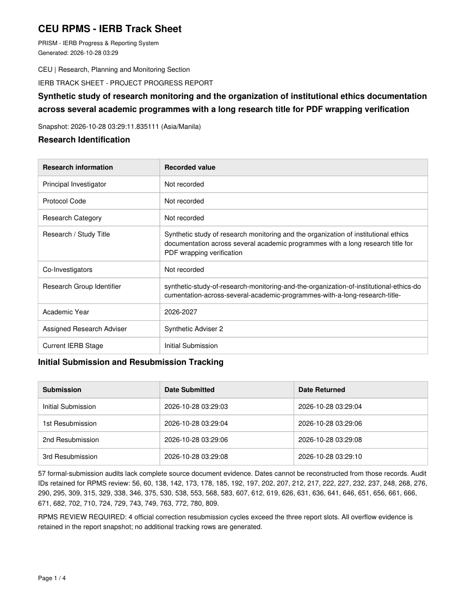
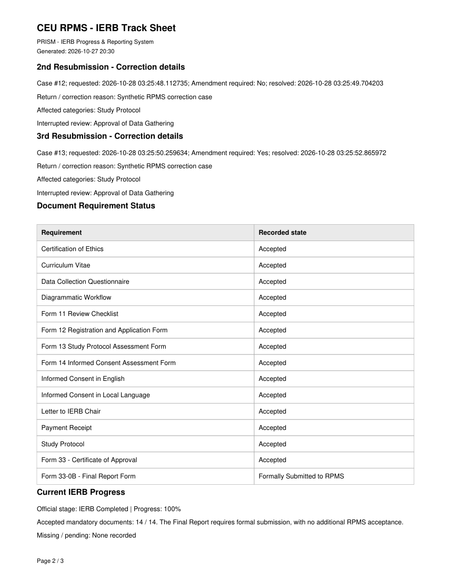
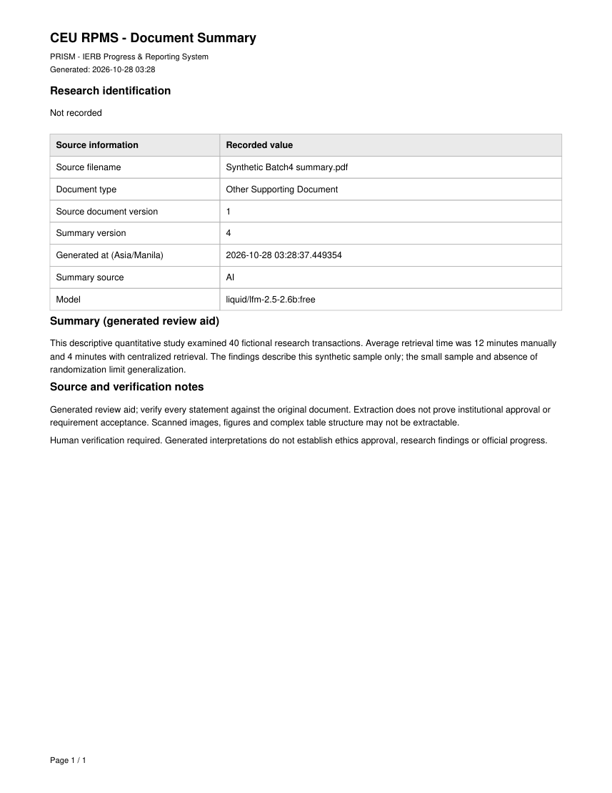
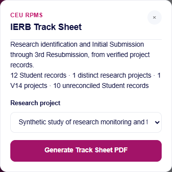

# PRISM V14 — Batch 4 review

Date: 2026-10-28, Asia/Manila. Repository: `Cloud11011/rpms_system`.

## Overall verdict: PASS WITH CONDITIONS

Batch 4 implements durable document-summary versions, private version-specific PDF exports, source-constrained AI progress assessments, and database-derived IERB track sheets with exactly Initial Submission, 1st Resubmission, 2nd Resubmission and 3rd Resubmission. The attached photograph supplied structure only. No handwritten names, titles, protocol codes or dates were used as application data.

All final acceptance checks pass. Conditions concern separately authorized production migration, unrecorded investigator/category fields, PDF font coverage and the limits of live-model accuracy verification. No unresolved critical test failure remains. Batch 5 is not started.

## Release identity and preservation

- Required starting commit, verified locally and against fetched origin: **`4da179e8619afa219ad8983d333ec08f6947770c`**.
- Established working branch: `feature/prism-v14-major-revisions`.
- Ending commit: the implementation commit containing this review, resolvable with `git log -1 --format=%H -- PRISM_V14_BATCH_04_REVIEW.md`. The exact ending local SHA, remote SHA and equality receipt are written after commit/push to [push-verification.json](PRISM_V14_BATCH_04_EVIDENCE/push-verification.json), and are supplied in the delivery message. A commit cannot contain its own resulting hash; the post-push receipt intentionally remains outside that commit.
- The original workspace and existing V14 worktree contained unrelated files and modified prior test evidence. They were preserved. Implementation used an initially clean linked worktree detached at the required commit; its reviewed commit is fast-forwarded onto the established branch before the ordinary push. No new development branch, main merge/rebase, reset of user work, force push or deployment.
- Batch 1–3 reviews and the existing report, summary, project, advancement, requirement, correction, history, retention and PDF paths were inspected before implementation. Earlier evidence accidentally refreshed by existing regression runners was restored only in this new worktree; new runners honor the separate evidence directory. See [preparation](PRISM_V14_BATCH_04_EVIDENCE/git-preparation.json) and [preservation receipt](PRISM_V14_BATCH_04_EVIDENCE/historical-evidence-preservation.json).

## Changed-file inventory

The exact code, test, migration and artifact inventory is recorded in [changed-file-inventory.json](PRISM_V14_BATCH_04_EVIDENCE/changed-file-inventory.json). Responsibilities are:

| Files | Responsibility |
| --- | --- |
| `includes/document_summary_history.php`, `document_summary_read.php` | Append-only summary history, honest legacy import, selection and audited version-specific PDF downloads. |
| `includes/document_summary.php`, `document_summary_ai.php`, `document_summary_actions.php` | Canonical-member de-identification, stronger source-only prompt, safe provider fallback, version persistence and mandatory audit in one transaction. |
| `includes/ierb_track_report.php`, `ierb_track_actions.php` | Deterministic evidence adapter, four-slot tracking, canonical aggregates, immutable snapshot capture, stale-source rejection and constrained AI organization. |
| `includes/report_pdf.php`, `reports_api.php` | Reuse the existing PDF engine; retain historical files, report history, downloads, deletion and legacy report modes. Route canonical Student reports to project track sheets and separate legacy distributions. |
| `documents_api.php`, `documents.php`, `reports.php`, `assets/js/documents.js`, `assets/js/reports.js`, `assets/css/documents.css` | Authorized history/version selector, PDF links, readable summaries, loading/error states and project/institutional report forms. |
| `includes/schema_v14.php`, `summary_schema_v14.json`, `maintenance/migrate-summary-history.php` | Explicit additive migration, pinned schema contract, no-write dry run, drift checks and retained-data rollback refusal. |
| `config.php`, `includes/schema_v12.php`, `schema_v13.php`, `account_lifecycle_schema.php`, `account_retention.php`, `ierb_v14_workflow.php`, `ierb_v14_requirements.php`, `research_projects.php`, `stage_configuration.php` | Recognize schema 14 without HTTP DDL/enrollment; preserve exact prior contracts, source retention and existing workflow semantics; allow caller-owned checklist transactions for atomic report capture. |
| `maintenance/ierb-report-tests/*`, modified group/project/V14 test runners | New unit, migration, HTTP, privacy, rollback, real correction-cycle, responsive and rendered-PDF checks; retained prior regression suites. |
| `PRISM_V14_BATCH_04_EVIDENCE/*`, this review | Synthetic acceptance results, actual rendered pages, source mappings and release evidence. Runtime databases, copied apps, credentials, sessions, provider logs and renderer dependencies are excluded. |

## Summary versioning and schema

Schema **14** is additive to the exact reviewed schema 13. `document_summary_versions` records the immutable summary ID, per-document version number, original document ID/version, text, Local/AI source, configured model when applicable, generating Admin, database generation timestamp, source SHA256, partial-extraction flag and processing limitations. A unique document/version index serializes numbering under existing Student/document locks. No application route updates or deletes earlier versions.

`documents.ai_summary` remains the compatibility cache of the latest result. On first generation with an existing saved value, its exact summary text is retained as version 1 before the new version is appended. Unknown historical generation times, models, authors and hashes remain NULL; unstructured historical source attribution is explicitly unknown. Read-only historical values and PDFs remain available before migration. New generation requires schema 14 so it cannot overwrite a saved value without durable history.

Summary append, latest-cache update and mandatory version-linked audit commit together. Extraction/provider calls hold no database locks. The exact document and file fingerprint are revalidated before save. The shared `prism_migrate` mutex protects persistence against concurrent empty rollback. Provider failures append a disclosed Local Summary only when safe local extraction succeeds; otherwise the saved history remains unchanged. Retained versions protect their source documents from single/bulk deletion and account purge, with restrictive foreign keys as a second safeguard.

`ierb_report_snapshots` stores the complete captured project/aggregate payload and SHA256 alongside the existing report record. Deliberate authorized report deletion cascades only its corresponding snapshot through the reviewed report-deletion path; it does not delete source document summaries or workflow history. Report generation captures data consistently under the existing Student fence, releases locks for AI/PDF work, then recaptures and compares the source fingerprint before atomic report/snapshot/audit persistence. An unconfirmed commit retains private bytes for reconciliation.

The migration runner accepts only an explicit DSN and credentials, CLI opt-in `PRISM_ALLOW_SCHEMA_V14_MIGRATION=1`, and an exact `PRISM_SCHEMA_V14_EXPECT_DB` binding. Dry run is the default. Exact v11/v12/v13/v14 contracts, foreign keys, no open transaction and the schema mutex are required. Published missing tables and drift fail closed. Empty rollback and interrupted empty operations are restart safe; retained summary/report rows block rollback. No existing records are backfilled, enrolled, deleted or rewritten by DDL. Instructions are in the [test/operator README](maintenance/ierb-report-tests/README.md).

## AI accuracy, privacy and UI safeguards

Document AI retains the OpenRouter/Liquid model and reviewed excerpt-confirmation flow. The prompt distinguishes source facts, methods, findings actually stated, and limitations/interpretation; it prohibits invented dates, decisions, progress, requirements, resubmissions or causes of delay. Canonical member identities are derived from explicit membership even when a legacy label is stale. Known identities, record identifiers and personal-record labels remain subject to the existing de-identification and confidentiality checks. Local Summary stays available after the reviewed history migration.

Progress AI receives only allowlisted stage/progress/count/date facts and backend-authored verified sentences. It may select their organization; arbitrary provider prose never becomes a factual claim. Invalid selections, unsupported prose and provider failures use deterministic local narrative. Names, titles, protocol codes, Adviser identifiers, internal reasons and document IDs are excluded from actual outgoing requests. Factual tracking cells are always computed by backend/database logic.

The UI uses safe text nodes, paragraph spacing and recognized headings, a dated version selector, explicit source/partial/limitation notices, a selected-version PDF link, loading states and existing modal focus behavior. No source-derived HTML executes. Summary history/PDFs and project/aggregate reports remain RPMS Admin-only. Existing Student file ownership and assigned-Adviser boundaries remain in force.

Source-based synthetic assertions verify numerical claims against the supplied synthetic excerpt. Mock-provider success/error fixtures, not live Liquid responses, supplied acceptance evidence. **Live-model accuracy is not certified.** Human verification against the original document remains required.

## Fixed tracking layout and field mappings

The individual PDF follows the photograph's research-identification area and bottom tracking grid while using a readable project-focused portrait layout. It places the actual research title prominently and retains protocol/group identifiers as secondary information. Section order is header, research identification, tracking/correction details, requirements, official progress, generated assessment and verification notes.

| Report field | Authoritative source / behavior |
| --- | --- |
| Research / Study Title; group identifier | `research_projects.research_title`, `public_identifier`; immutable project ID retained in the snapshot. |
| Principal Investigator; Co-Investigators | Not recorded: canonical membership and submission-holder designation do not establish investigator roles. No role is inferred. |
| Research Category | Not recorded: no authoritative category field exists in the current canonical schema. |
| Protocol Code | Designated holder's recorded `students.protocol_code`, explicitly disclosed as that source; absent values stay Not recorded. |
| Academic Year | Agreement among recorded canonical member `students.academic_year` values; missing/conflicting values are disclosed. |
| Assigned Research Adviser | Canonical `research_projects.adviser_id` joined to `advisers.full_name`; displayed only locally. |
| Current stage / progress | The project's authoritative `ierb_workflows` and existing V14 checklist/stage service, including interrupted correction context. |
| Initial Date Submitted | First valid recorded formal document submission before the first correction boundary, requiring the document stamp plus mandatory formal-submission audit. Never upload time or `students.last_submission_date`. |
| Numbered resubmissions | Chronological correction cases with actual audited formal submission of an affected successor or required Amendment; multiple documents in one case remain one cycle. Cases without formal evidence do not consume a slot. |
| Date Submitted | Original valid `documents.rpms_submitted_at`, supported by `document_submitted_to_rpms`, `document_resubmitted_to_rpms` or authorized override submission audits. Earliest qualifying case submission marks cycle start, not completion of every correction document. |
| Date Returned | Separate `document_returned_for_revision` audit timestamp after the cycle's submission and before the next cycle's submission. Opening a case alone supplies neither submission nor return. |
| Correction details | Case reason, opening/resolution times, interrupted stage, affected version/category snapshots and Amendment policy, only for the represented slots and authorized Admin view. |
| Required document status | Existing version-bound RPMS acceptance/formal-submission ledger and current-version checks; uploaded does not mean accepted. |
| Form 33 | Existing verified acceptance with institutional approval reference. |
| Form 33-0B / completion | Authorized formal submission, completion event and `research_projects.completed_at`; no additional RPMS acceptance action. |
| Latest activity | Recorded document audits, workflow events and project events. |
| Counts / distributions | Active Student records and distinct canonical project IDs separately; V14 project stages and legacy Student stages never silently combined. Unreconciled Student records and unlinked V14 workflows are explicitly labeled. |

The tracking table has **exactly four rows**: Initial Submission, 1st Resubmission, 2nd Resubmission, 3rd Resubmission. No 4th/5th/later row is generated. Missing, invalid and incomplete timestamps stay unknown. Same-second order uses audit IDs and case boundaries; ambiguous evidence is flagged. Extra historical official cycles trigger **RPMS REVIEW REQUIRED**, while all cases, overflow evidence and supporting audits remain in the immutable reporting snapshot. The underlying correction workflow has **no new three-case limit**.

## Rendered PDF and responsive evidence

Actual PDFs were rasterized with PyMuPDF. Every page was checked for text bounds, repeated headers/footers, fixed row labels and pagination; representative rendered pages and light/dark dialogs were visually inspected. The long-title/long-requirement stress fixture is explicitly synthetic and is not presented as operational research data. [Rendering results](PRISM_V14_BATCH_04_EVIDENCE/pdf-rendering.json) list every current page.

`.gitattributes` preserves evidence PDFs as exact binary bytes, including required cross-reference spacing. The same shared PDF writer supplies summary and project exports; a second rendering engine was not introduced. Long titles wrap, tables retain borders and repeat headings on continued pages, and page numbering is accurate. Built-in Latin fonts transliterate unsupported characters; the retained JSON/database values preserve UTF-8 originals.

## Acceptance results

| Check | Final result / evidence |
| --- | --- |
| Full legacy schema-11 HTTP/browser/security regression | PASS, 310 assertions — `legacy-v11.json`. New generation safely requires migration; existing history/reports remain available. |
| Batch 1 foundation and migration/race suite | PASS, 99 assertions — `foundation-tests.json`. |
| Full schema-12 regression with Batch 2 documents and Batch 3 canonical groups | PASS, 724 assertions — `legacy-v12-projects.json`; included document suite 412 and project suite 96. |
| Document/canonical workflow on new schema 14 | PASS, 429 total runner assertions; 415 document/integration assertions — `schema14-workflow.json`, `schema14-document-tests.json`. Includes canonical privacy despite a stale legacy label and exact automatic Final Report completion reporting. |
| Batch 4 final HTTP/browser integration | PASS, 136 total runner assertions; 124 Batch 4 assertions — `batch4-final.json`, `batch4-integration.json`. |
| Independent summary-schema migration matrix | PASS, 8 cases — `summary-migration-tests.json`; opt-in/binding, transaction/FK requirements, replay, drift, missing published table, empty rollback/reapply. The already-passed matrix is separate from the final focused HTTP run. |
| Deterministic tracking unit cases | PASS, 44 assertions — `cycle-tests.json`; zero through fourth cycle, fixed labels, chronological numbering, multi-document deduplication, separate returns, optional/required Amendment, missing/invalid timestamps and incomplete evidence. |
| PHP and JavaScript syntax | PASS — `php-syntax.json`, `javascript-syntax.json`. |
| Real PDF pages, long-title/table pagination and responsive dialogs | PASS — `pdf-rendering.json`; 390/768/1440 light/dark dialog captures. |
| Diff/staged whitespace and selected-file review | PASS before the authorized commit; final results recorded in `acceptance-summary.json`. |
| Disposable fixture teardown | PASS after final checks; receipt in `teardown.json`. No production database access. |

Batch 4 checks cover legacy import, multiple versions, correct ordering/source versions, preserved earlier values, provider errors and Local fallback, partial extraction, old-version PDFs after source supersession, authenticated/unauthenticated/role/cross-document isolation, mandatory audit-failure rollback, immutable snapshots, current evidence changing during AI generation, actual de-identified provider payloads, correct two-member/one-project counts, and four real formally submitted correction cases without a workflow limit. The fourth-cycle database snapshot is retained in `fourth-cycle-exception.json`.

Exploratory fixture and integration failures are disclosed in `development-failures.json`; they are not counted as acceptance passes. They included a correctly rejected TXT fixture, a fixture that put all text on an identity-labeled line, mock prompt misclassification, an assumed unrelated document after cleanup, the report route's missing schema-helper include, and browser interaction with contextual/portalled menus and the existing navigation backdrop. Final reruns pass after fixes; upload/security policies were preserved.

## Known limitations and production boundary

- Investigator roles and research category require separately authorized authoritative data capture. This batch displays Not recorded rather than inferring roles from the holder or roster.
- Pre-existing summary metadata was not recorded historically; it cannot be reconstructed. Old summaries remain readable and are imported honestly on first new generation.
- Formal dates missing complete source records, ambiguous case boundaries or valid database timestamps remain unrecorded and flagged. Historical audits and overflow evidence are retained; no invented cycles or dates repair those gaps.
- Document extraction omits unsupported scanned images/figures and may flatten complex tables. Bounded excerpts are marked partial. External-provider availability and factual accuracy remain subject to human verification.
- Exact schema contracts were verified on MariaDB 10.4.32/PHP 8.2.12. Other database metadata formats require review rather than regenerating contracts to accept unexplained drift. Browser evidence covers Chromium, not unclaimed cross-engine certification.
- The existing Student-range fence is deliberately retained for consistent canonical reporting. Very large institutional datasets need capacity evaluation before operational rollout.
- The historical report files, report modes, history, source document chains, security boundaries, four-stage workflow and automatic Form 33-0B completion remain intact. Only newly generated legacy aggregates exclude V14 members and state their legacy statistical scope.
- New summary generation and project reporting require the separately reviewed/operator-authorized schema 14 migration. **No production migration, enrollment/activation, Hostinger deployment, main merge/rebase or Batch 5 work was performed.**

Commit and ordinary push use the authorized message `feat(prism-v14): version AI summaries and enhance IERB progress reports`. Delivery requires verified equality of local and remote branch SHAs, captured in the post-push receipt. Stop after that verification.
