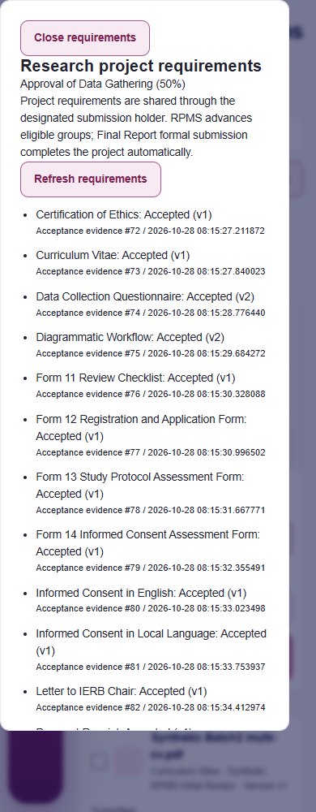
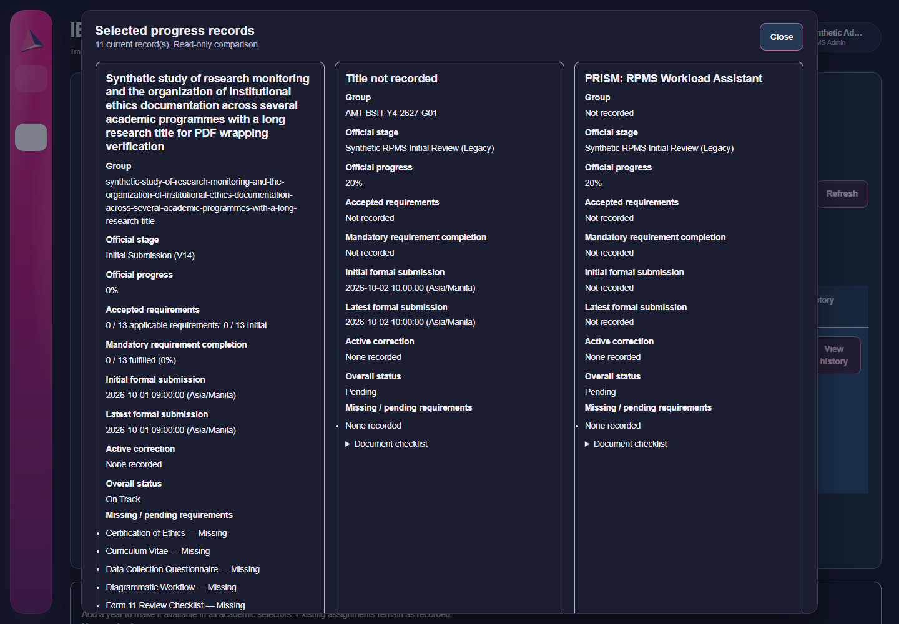
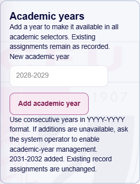
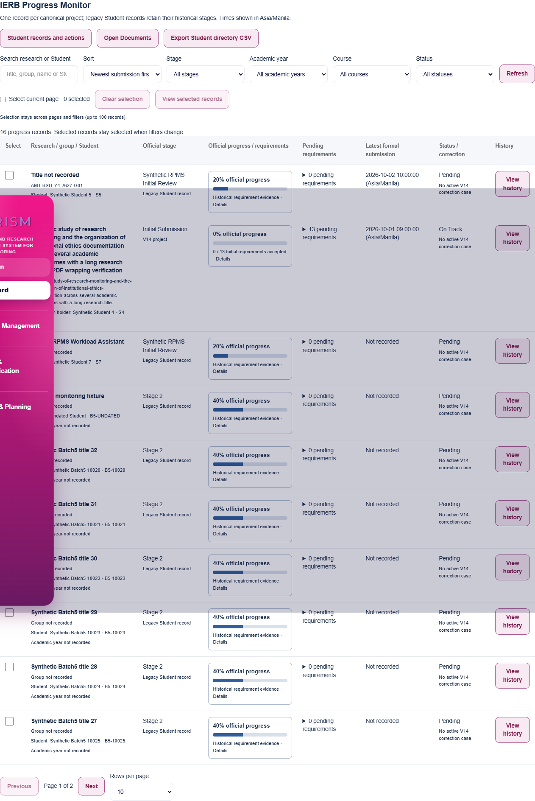

# PRISM V14 — Batch 5 review

Date: 2026-10-28 (Asia/Manila). Repository: `Cloud11011/rpms_system`.

## Overall verdict: PASS WITH CONDITIONS

Batch 5 adds shared authoritative IERB monitoring, server-side submission/title sorting, read-only project comparison, accessible requirement details, paginated submission history, and an additive academic-year catalog. The four-stage workflow, conditional corrections, canonical reconciliation, automatic Final Report completion, summary history, and fixed four-row IERB Track Sheet remain intact.

Production migration, production activation, deployment, main merge/rebase, and Batch 6: **not performed**. Academic-year additions require the separately authorized operator migration described below.

## Git identity and preservation

- Required starting commit, fetched origin branch, and independently checked remote SHA: **`fa61586f7a1a6e80fe94531afed00894181baf6c`**.
- Working branch: `feature/prism-v14-major-revisions`.
- The original checkout and existing V14 worktree contained unrelated files and modified prior evidence. They were preserved. Implementation began in an initially clean linked worktree, `.batch05-worktree`, detached at the approved baseline. Branch handoff preserves the existing worktree's contents before attaching the reviewed implementation to the established branch.
- All four prior batch reports were read; their SHA256 values are in [git-preparation.json](PRISM_V14_BATCH_05_EVIDENCE/git-preparation.json). Existing modified evidence is protected by a separate [preservation receipt](PRISM_V14_BATCH_05_EVIDENCE/existing-worktree-preservation.json). No historical review/evidence file is staged as a Batch 5 modification.
- Ending SHA: the implementation commit containing this report, resolvable with `git log -1 --format=%H -- PRISM_V14_BATCH_05_REVIEW.md`. The exact local and remote ending SHAs and their equality are recorded after push in [push-verification.json](PRISM_V14_BATCH_05_EVIDENCE/push-verification.json). That generated receipt remains outside its own commit, avoiding a circular commit hash. The delivery message supplies the exact SHA.
- Authorized commit message: `feat(prism-v14): improve IERB monitoring and academic year management`. Only an ordinary push to `origin feature/prism-v14-major-revisions` is authorized; no force push or merge into main.

## Changed-file inventory

The exact selected file list is in [changed-file-inventory.json](PRISM_V14_BATCH_05_EVIDENCE/changed-file-inventory.json).

| Files | Responsibility |
| --- | --- |
| `includes/ierb_monitor.php`, `ierb_monitor_view.php`, `assets/js/ierb-monitor.js`, `assets/css/ierb-monitor.css` | Shared scoped SQL projection, current authoritative checklist, comparison, submission history, accessible popover/modal and responsive controls. |
| `dashboard.php`, `ierbprog.php`, `ierb_api.php`, `assets/js/ierbprog.js`, `assets/js/prism-ui.js` | Monitor integration, separate statistical units, research/group identity, verified Student-list dates and sorting, current CSV fields, refresh events and reuse of the existing focus-trapping modal. |
| `includes/academic_years.php`, `academic_catalog.php`, `academic_year_seed.json`, `academic_year_manager.php`, `academic_years_api.php`, `assets/js/academic-years.js`, `includes/record_filters.php` | One durable year source, validated Admin creation, historical compatibility, selector updates and mandatory audits. |
| `students_api.php`, `ierb_api.php`, `includes/account_onboarding.php` | Transactional before/after evidence for authorized individual academic-year assignments. |
| `includes/schema_v15.php`, `academic_schema_v15.json`, `maintenance/migrate-academic-years.php` | Additive, explicitly authorized catalog migration, pinned contract, dry run and retained-data rollback refusal. |
| `config.php`, schema/retention/stage/workflow/project/summary availability helpers | Recognize exactly schema 15 while preserving frozen schema 11–14 definitions, workflow activation gates, evidence retention and existing report availability. |
| `maintenance/ierb-monitor-tests/*`, prior group/document/report runners | Synthetic integration, authorization, concurrency, migration, browser, chronology and regression verification; isolated evidence outputs preserve prior artifacts. |
| `.gitattributes`, `PRISM_V14_BATCH_05_EVIDENCE/*`, this review | Acceptance receipts, disclosed development failures, synthetic screenshots and rendered PDF evidence. Runtime databases, copied apps, provider logs, sessions, tools and dependencies are excluded. |

## Monitoring, identity, sorting and filtering

Dashboard and IERB Progress use the same read-only monitor. Canonical membership resolves one row per immutable project ID and its designated submission holder. Titles and public group identifiers come from the canonical project. The holder is labeled as a submission holder, without inventing investigator roles. Unreconciled enrolled workflows retain separate Student identities. Legacy records retain their historical numeric stage labels and percentages; a legacy Stage 2 is never treated as V14 correction Stage 2.

Official stage/progress come from the existing semantic workflow/checklist, including the correction's interrupted context. Initial Submission is 0%, Approval of Data Gathering is 50%, and verified automatic completion is 100%. Requirement acceptance and fulfillment are separate metrics. Accepted counts never come from uploaded-file totals. A formally submitted Final Report fulfills its requirement without a fictional RPMS acceptance.

The shared SQL projection supplies status labels, status filters and counts consistently, including `Correction open` and `IERB Completed`. Search, academic-year/course/stage/status filters, allowlisted sort columns, counts and ordering execute before server-side page slicing. Newest submission is the default, with oldest submission, title A–Z/Z–A and retained stage/status/Student ID/year choices. Missing dates stay visible and last in both date directions; the stable Student record ID resolves ties. Canonical projects are not repeated for each member. The separate Student action directory and guarded group advancement tools remain available, with links to documents and the complete Student CSV export.

Canonical formal dates require a valid holder-owned document submission stamp plus its matching formal-submission audit and recorded `Submitted to RPMS` result. Legacy rows use the same verified stamp, falling back to the matching retained document's formal audit timestamp when the stamp is absent/invalid. This fallback is disclosed in the interface and operator/test documentation. A manual `last_submission_date`, Student update, upload, academic-year assignment or summary generation cannot establish a formal date. Missing source evidence remains unknown. The existing Student directory/CSV also use verified formal dates and current canonical titles/progress, while retaining separate Student rows.

Results refresh after local document/progress changes, explicit refresh, visibility restoration and window focus. Request sequence guards discard obsolete responses. Dashboard stage distributions distinguish V14 project/enrolled records from legacy Students. The completed legacy Student metric excludes V14 memberships rather than silently reinterpreting their stored stage snapshots.

## Selection, accessibility and submission history

Selection uses `project:<id>` or `student:<id>`, never names/titles. Admins can select one/many records, select the current page, clear all, and compare records across pages and filters. Selection remains in memory until navigation/reload, is bounded at 100 records, and displays its count. Every comparison re-resolves its keys in the current authorized query; duplicate projects count once and stale/archived/unavailable keys are disclosed and removed. Selection exposes no mutation action. Existing stage advancement, approvals, corrections and archive operations retain their separate guarded interfaces.

The comparison shows title, group, official model/stage/progress, accepted/fulfilled requirement counts, pending labels, first/latest verified formal dates, active correction/Amendment decision and overall status. The existing modal supplies focus trapping, Escape and origin restoration; its Close control remains accessible at the top while long comparisons scroll.

Progress buttons reveal a body-level checklist on hover or keyboard focus, and open a focusable persistent panel on click/touch. Escape and Close restore the initiating control. Fixed placement is clamped inside the viewport; bounded scrolling avoids clipping inside tables. All 13 Initial labels use current version-bound states. Form 33 and Final Report remain distinct later requirements; Amendment appears as mandatory only when RPMS explicitly required it in the current correction case. Uploaded/pending, formal submission, returned and accepted states remain distinct. No source bytes, summaries, institutional reference text, internal reasons or document-download links are exposed by this component.

Admin history paginates retained formal submission categories, separate return audits, correction openings and explicit Amendment decisions, correction resolutions, official workflow events and completion timestamps. Opening a case or uploading a file never fabricates a submission. Recorded timestamps are labeled Asia/Manila. History has no resubmission-count limit. The Batch 4 report retains exactly Initial Submission, 1st, 2nd and 3rd Resubmission rows, with later evidence retained and flagged according to its established reporting rule.

## Academic-year model and migration

Schema **15** adds only `academic_years`: unique `year_label`, historical/import flag, responsible Admin reference and catalog creation timestamp. Database checks enforce consecutive `YYYY-YYYY` values for new entries; historical values remain retained verbatim. The migration copies the three previously offered compatibility years and distinct stored Student years, including archived records. It rewrites no Student/project assignment, title, group, document or workflow.

`academic_catalog()` is the common source for registration/profile completion, Student management, IERB forms, group/cohort controls and filters. Reports/exports retain actual recorded academic years; no catalog addition changes historical reports or assignments. Adviser controls without an academic-year field acquire no unrelated new field. Mounted academic selectors receive newly created years while preserving their selected values. The compatibility seed is migration data, not a fixed client/backend validation allowlist.

Only a live eligible RPMS Admin can add a year. Format/consecutive-year checks, duplicate rejection, current session/generation, same-origin POST and mandatory transactional creation audit apply. A primary-key constraint and shared schema mutex protect concurrent creation. Existing authorized individual year changes, including profile completion, now carry mandatory before/after audits in their own save transaction. Audit failure rolls back the assignment/addition. There is no deletion, replacement, bulk reassignment, promotion or automatic active-year change.

The operator runner defaults to a no-write dry run and accepts only explicit DSN/credentials, `PRISM_ALLOW_SCHEMA_V15_MIGRATION=1`, exact `PRISM_SCHEMA_V15_EXPECT_DB`, enforced foreign keys, no open transaction, the schema mutex and exact pinned contracts. It verifies preserved schema 11–14 tables and all new definitions. Published missing tables and drift fail closed; older migration runners cannot bypass the new retained catalog. Partial unpublished DDL and empty rollback are restart safe. Any retained catalog rows block rollback; disable additions and retain the catalog after use. Fixture-only cleanup deliberately removes synthetic data before testing empty rollback and is not an operational deletion procedure.

Instructions and the full evidence/fallback policy are in [maintenance/ierb-monitor-tests/README.md](maintenance/ierb-monitor-tests/README.md). Before operator migration, existing selectors remain usable and additions explain their prerequisite. Ordinary HTTP requests perform no extension DDL, enrollment or reconciliation.

## Acceptance evidence

Final critical failures: **0**. [Acceptance summary](PRISM_V14_BATCH_05_EVIDENCE/acceptance-summary.json).

| Check | Result / evidence |
| --- | --- |
| Final full legacy schema-11 HTTP/browser/security regression | PASS, 310 assertions - `legacy-v11-final.json`. |
| Batch 1 foundation, migrations and independent races | PASS, 99 assertions - `foundation-tests.json`. |
| Full schema-12 regression plus canonical/document workflow on schema 15 | PASS, 734 runner assertions - `full-schema12-and-schema15-workflow.json`. |
| Final focused schema-15 document/project/automatic-completion verification | PASS, 438 runner assertions; 424 embedded document assertions, including completed-status filtering - `final-schema15-documents-runner.json`, `document-tests.json`. Embedded project checks: 96 - `project-tests.json`. |
| Batch 4 summary/history/AI/PDF/correction regression | PASS, 136 runner assertions; 124 embedded checks - `batch4-regression-runner.json`, `batch4-integration.json`. |
| Independent schema-14 migration matrix | PASS, 8 cases - `summary-migration-tests.json`. |
| Fixed tracking/history unit cases | PASS, 44 assertions - `cycle-tests.json`. |
| Batch 5 final monitoring/catalog/migration/browser acceptance | PASS, 245 runner assertions; 233 embedded Batch 5 checks - `batch5-final-runner.json`, `batch5-integration.json`. Includes all 13 schema-15 migration cases in `academic-migration.json`. |
| PHP / JavaScript syntax | PASS, 157 PHP files and 47 JavaScript/CJS files - `php-syntax.json`, `javascript-syntax.json`. |
| Rendered PDF bounds, headers/footers, fixed rows and pagination | PASS, 10 PDFs / 27 pages - `pdf-rendering.json`. |
| Responsive Dashboard/monitor/checklist/comparison and accessible interactions | PASS, all five widths in light/dark; no JavaScript errors - `responsive.json` and named screenshots. |
| Final exact fixture schema / teardown | PASS, exact schema 11; verified synthetic MariaDB stopped - `teardown.json`. |
| Complete selected source review and whitespace | PASS; exact staged inventory, whitespace and all 10 staged PDF byte hashes verified - `source-review.json`. |

Runner totals describe separate executions. Embedded document/project/migration assertions overlap those totals and are not added again. Negative-path tests intentionally reject invalid input, unauthorized roles, stale state and injected persistence faults.

Development failures are disclosed separately in [development-failures.json](PRISM_V14_BATCH_05_EVIDENCE/development-failures.json). They included fixture ID/count assumptions, delayed onboarding/sidebar interaction, existing document-menu search reload timing, and mobile dashboard overflow exposed by long status badges. Fixture SQL now fails immediately, its IDs occupy a separate range, tests wait for actual filtered results, and scoped wrapping/sizing fixes address the layout defects. These exploratory runs are not acceptance passes.

The fixture verifies its actual disposable MariaDB datadir before operations. Production configuration/credentials are never loaded; provider/email responses are synthetic. Existing account/session/CSRF, ownership, assigned-Adviser, group advancement, current-version, correction, acceptance, automatic completion, summary/report retention, PDF and audit paths remain covered. Final fixture teardown and exact schema verification are recorded in [teardown.json](PRISM_V14_BATCH_05_EVIDENCE/teardown.json).

## Responsive and rendered evidence

The matrix covers Chromium at 390, 768, 1024, 1440 and 1920 pixels in light and dark themes. Tests cover keyboard focus/return, mouse hover, mobile tap, popover bounds, comparison wrapping, selection across genuine pages/filters, and both Dashboard and IERB Progress page bounds. The table scrolls within its own labeled region. A narrow repository status badge now wraps without retaining an off-screen inherited margin; existing sidebar/navigation behavior is unchanged.

The existing binary Git attribute is extended to Batch 5 PDFs so xref spacing and offsets retain exact bytes. Actual regression PDFs are rasterized and checked for text bounds, headers/footers, pagination and the fixed report rows. Synthetic UI/PDF data is not operational research evidence. Representative checklist/comparison pages and actual PDF pages were visually inspected.

## Limitations and release boundary

- Production academic-year creation requires the separately reviewed schema 15 migration. No production migration, workflow activation/enrollment, deployment, Hostinger action, main merge/rebase or Batch 6 implementation was performed.
- Unknown or incomplete historical submission evidence remains unrecorded. Legacy fallback requires a retained matching source document and formal audit. No missing date is reconstructed from upload/modification/summary/year changes.
- Exact schema contracts were tested with MariaDB 10.4.32/PHP 8.2.12. Other database metadata formats require review. Browser evidence covers Chromium, without claiming cross-engine or live screen-reader certification.
- Monitoring reuses the conservative Student-range fence and existing authoritative checklist validation. Institution-scale throughput was not benchmarked; records requiring canonical authority/account reconciliation fail closed rather than acquiring inferred progress.
- Selection is intentionally session-page memory, with at most 100 comparisons, and clears on navigation/reload. No selected-record mutation was introduced.
- Existing AI/extraction accuracy and PDF font limitations remain those documented in Batch 4. Synthetic provider tests do not certify live model accuracy.

Git push verification is the final release action: confirm the local branch SHA equals the remote branch SHA, retain the verification receipt, then stop. Batch 6 requires the user's next explicit authorization.
