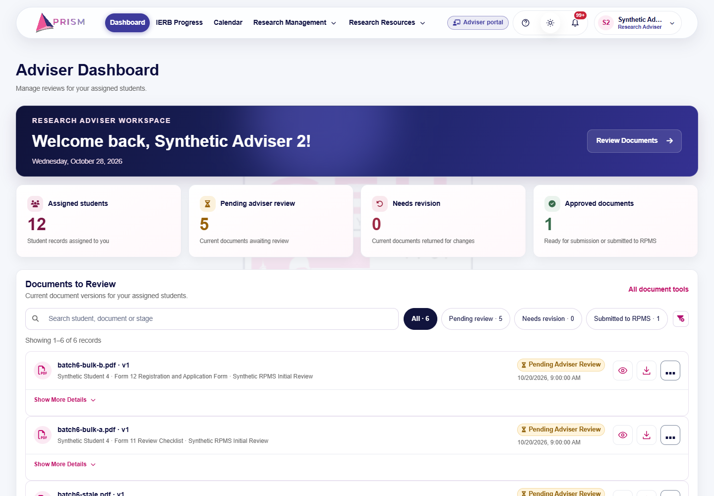
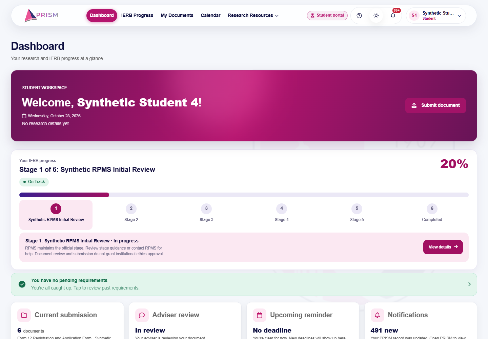
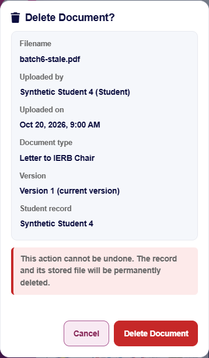
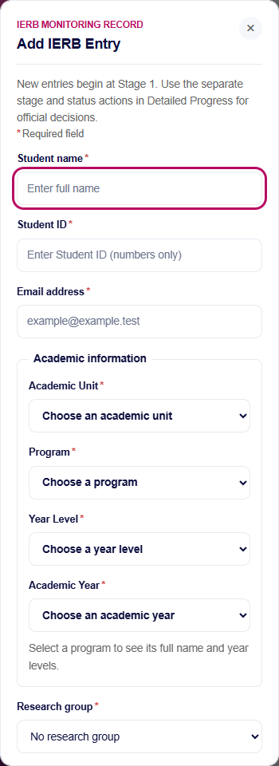

# PRISM V14 — Batch 6 review

Date: 2026-10-28 (Asia/Manila). Repository: `Cloud11011/rpms_system`. Branch: `feature/prism-v14-major-revisions`.

## Overall verdict: PASS WITH CONDITIONS

Batch 6 adds:

- form placeholders;
- attribute-driven red required-field asterisks;
- numeric-only Student/School IDs, enforced on the server, with historical IDs preserved;
- consistent Save/Submit/Cancel behavior with gating and duplicate-request prevention;
- clearer account pages;
- a restrained Student/Adviser color distinction with a text-and-icon role cue;
- deletion confirmations that show the filename and the recorded uploader for single and bulk deletion.

Final critical failures: **0**. The conditions are listed in "Known limitations". In short:

- Hostinger remains on schema 11, and V14 features that need schemas 12–15 are not yet operational.
- Browser evidence is Chromium-only.
- A few forms intentionally keep the "prevented on click with an inline error" pattern.
- One frontend/backend required-field discrepancy is left for a Batch 7 decision.

**Not performed:** production or Hostinger database access, migration or activation; V14 enrollment; manual deployment; main merge or rebase; force push; Batch 7.

## 1–2. Git identity

- Starting commit (required, local, fetched origin and `ls-remote`): **`ee4d561637c9cd2c56680aa2905c782601121536`**. See [git-preparation.json](PRISM_V14_BATCH_06_EVIDENCE/git-preparation.json).
- Work happened in the existing linked worktree `.batch05-worktree`. At start it was attached to the required branch at that commit with no tracked modifications. Its three unrelated untracked items were preserved and not staged: the fixture sandbox and two Batch 5 post-push/diagnostic files. The original checkout was not touched. The SHA256 of all five prior reports is recorded.
- Ending SHA: the commit containing this report, resolvable with `git log -1 --format=%H -- PRISM_V14_BATCH_06_REVIEW.md`. A commit cannot contain its own hash. The exact local/remote equality receipt is written after the push to `PRISM_V14_BATCH_06_EVIDENCE/push-verification.json` (outside the commit) and is given in the delivery message.
- Commit message: `feat(prism-v14): finalize forms account UX and deletion safeguards`. Ordinary push only.

## 3. Changed-file inventory

The exact staged list is in [changed-file-inventory.json](PRISM_V14_BATCH_06_EVIDENCE/changed-file-inventory.json).

| Files | Responsibility |
| --- | --- |
| `assets/js/prism-forms.js`, `assets/css/prism-forms.css` (new); `includes/frontend_styles.php` | Shared module loaded on every page through `prism_frontend_styles()`. Covers required markers, numeric Student ID fields, opt-in submit gating, the native duplicate-submit guard, field and gate messages, readable placeholders and focus rings, button states, the read-only field style, the deletion review style and role accents. |
| `assets/js/prism-ui.js` | `confirmDocumentDelete()`; confirmations that stay open with a pending state and in-place failure (`onConfirm`, `confirmDisabled`); reason placeholders and required semantics; `busy()` sets `aria-busy` and re-applies gating; `dirtyForm().clean()` notifies the gate; request errors carry the HTTP status. |
| `documents_api.php`, `includes/document_management.php` | Read-only `delete_preview`; optional `expectedVersion` binding on `delete`; a per-record list in the bulk preview. |
| `assets/js/documents.js`, `assets/js/adviser-dashboard.js`, `documents.php` | Shared single-delete dialog; bulk review list; repaired mojibake confirmation strings; reason placeholder. |
| `includes/account_onboarding.php`, `students_api.php`, `ierb_api.php` | `onboarding_student_id()`, enforced on profile completion, Student Records and IERB entry. IERB entry creation now requires the research title on the server, as the form already did. |
| `account.php`, `assets/js/account.js`, `role_portal.php` | Account UX: read-only notes, placeholders, password visibility toggles, match validation and gated Save. |
| `admin_people.php`, `assets/js/admin-management.js`, `ierbprog.php`, `assets/js/ierbprog.js`, `complete_profile.php` | Placeholders, numeric Student ID fields, legacy-ID handling, gate modes (valid for new records, dirty for edits) and secondary Cancel styling. |
| `includes/prism-navigation.php` | Adviser role chip (`role_portal.php` carries the Student chip). |
| `help_support.php`, `admin_notifications.php`, `account_setup.php`, `admin_legal_policies.php`, `research_adviser.php`, `login.php`, `register.php`, `forgot_password.php`, `reset_password.php`, `legal_consent.php`, `includes/staff_registration_card.php`, `assets/js/calendar-deadlines.js`, `assets/js/ierb-requirements.js` | Placeholders, the native duplicate-submit guard, busy labels and gating where safe. |
| `maintenance/ierb-ui-tests/*` (new), `maintenance/ierb-group-tests/run.cjs` | Batch 6 acceptance module, unit fixture and README; runner hook `PRISM_TEST_BATCH6=1`. |
| `maintenance/ierb-monitor-tests/integration.cjs` | Prior-batch harness fixes (disclosed): it now honors `PRISM_TEST_EVIDENCE_DIR` (it previously overwrote Batch 5 evidence) and removes only its own `batch5-order-*` synthetic audits. |
| `PRISM_V14_PDF_REQUIREMENTS_TRACEABILITY_DRAFT.md`, `PRISM_V14_BATCH_07_AUDIT_HANDOFF.md`, this review, `PRISM_V14_BATCH_06_EVIDENCE/*` | Batch 7 preparation and evidence. Only JSON receipts are kept under `regression/`. Regression screenshots and PDFs, runtime data, sandboxes, logs and dependencies are excluded. |

There is no schema change and no new migration.

## 4. Form UI improvements

Placeholders were added to every editable text input and textarea that lacked one in the inventoried forms. Labels stay visible. Native selects with clear default options get none.

The examples follow the brief: `Enter full name`, `Enter Student ID (numbers only)`, `Enter the complete research title`, `Explain the reason for this action`, `Enter notes for the student (required when denying…)`, and `example@<first configured domain>`. The email example uses a generic local part, never a real person's address. Generic placeholders were replaced (for example "Type it again" and "Leave blank if none").

Placeholder color is a token: 4.92:1 in the light theme on the Student profile (measured), and readable in dark mode (the test asserts at least 3:1). Inputs and buttons get visible `:focus-visible` rings.

## 5. Required-field inventory

The full table of 23 forms is in [required-field-inventory.json](PRISM_V14_BATCH_06_EVIDENCE/required-field-inventory.json).

- Markers follow the **live** `required`/`aria-required` state of enabled, editable, non-hidden controls. This includes fields that scripts toggle (academic fields, the conditional Adviser remarks, the conditional deletion reason).
- Read-only and disabled fields are never marked, for example Email, Role, Student ID and Account ID on profile pages, and the read-only stage/status.
- The asterisk is `aria-hidden`, so accessible names stay clean ("Student ID", verified with a role query) and native `required` announces the state.
- No optional field was made mandatory.

Comparison against backend validation: everything matches except **IERB entry edit**. There the UI requires the research title but the server still accepts a blank title on edit, for legacy compatibility. Creation now matches. This is recorded for a Batch 7 decision.

## 6. Numeric Student ID behavior

- **Server rule** (`onboarding_student_id`): `^[0-9]{1,100}$` for new IDs, and for changed IDs on Student Records and IERB edits. Profile completion applies it to the new ID. The value stays text, so leading zeros are kept (`0026600001` is stored and used as the login username unchanged).
- Rejected inputs: letters, spaces, symbols, signs, decimals and full-width digits. Duplicate IDs remain rejected (409).
- **Historical IDs.** An unchanged historical ID (for example `S5`, or a modeled `B6-LEGACY-01`) is accepted and never rewritten. Changing it requires a numeric value. The Student with a legacy ID can still sign in. No data was migrated and no schema was added.
- **Client.** The field is a text input with `inputmode=numeric`. Typed non-digits are blocked with a live message. Pasted values are rejected with a message when they contain non-digits; surrounding spaces are trimmed and nothing else is silently rewritten. Programmatic or autofilled non-digits are marked invalid (`aria-invalid`) and block Save. When editing a record, the unchanged historical ID shows "retained as recorded".
- **Employee IDs** were **not** changed. The staff registration rule explicitly allows letters, and no institutional rule supports restricting them.

## 7. Button and form-state changes

- **Gated forms (`data-prism-gate`):**
  - Account profile and Student profile: Save requires an actual change.
  - Both password forms: complete and matching.
  - Student/Adviser record modal and IERB entry: valid for new records; valid and changed for edits.
  - IERB note, profile completion, Help & Support page, invite dialog: valid.
  - A visible, `aria-describedby`-linked status explains why the button is unavailable.
- **Duplicate prevention.** JS-handled forms already use `PrismUI.busy` (disabled, a loading label and now `aria-busy`). Repeated Enter is blocked because implicit submission does not fire while the default button is disabled. After success or failure, gating is recomputed. Values are preserved on failure (tested with a synthetic 500).
- **Native POST forms** (login, staff registration, forgot/reset password, legal consent, legal policy administration, staff registration codes) get a one-time submission guard with busy labels. The guard is cleared on `pageshow` (back/forward cache).
- **Cancel** is never gated. It closes without requests (tested). The gate ignores a nested button bound to a different form (for example "Log out instead").
- **Visual consistency:**
  - Primary actions keep the PRISM primary color.
  - Unclassed Cancel/Close buttons in action rows get a neutral secondary style.
  - Delete/Permanently Delete use one solid danger style.
  - Disabled primary/danger buttons use a neutral, legible disabled style instead of faded brand color.
- **Intentionally not hard-disabled:**
  - Reasoned `PrismUI.confirm` dialogs keep "click → inline error". An accepted Batch 1 browser test verifies this, and the brief permits "otherwise prevented from submitting".
  - The Help & Support modal (chip picker with its own validation).
  - The notifications composer and the Adviser review dialog (their own logic).
  - The forced password change and account setup pages already had their own gating.

## 8. Account UI/UX updates

- Editable fields are separated from institutional read-only fields (dashed muted style plus "Read only · …" notes linked by `aria-describedby`).
- Each form has a required legend, and name length limits now match the server (190).
- The Student portal labels the field "Student ID", not "Student / Employee ID", and its copy explains what is editable.
- The Admin/Adviser password form gained show/hide controls with labels such as "Show new password" and `aria-pressed` state. They reset after a successful change.
- Feedback appears beside the field for mismatch and invalid IDs, and next to the button for gate status.
- Permissions, lifecycle rules, session checks and password policy are unchanged. No field became newly editable.

## 9. Student / Adviser color differentiation

- The Student portal keeps PRISM magenta `#b5146e`.
- The Adviser interface uses PRISM indigo `#3d3a9c` (dark mode `#4b47b8`) for the active navigation, nav hover, the hero gradient (navy → indigo), the profile role label and a role chip.
- The chip shows "Student portal" with a graduation-cap icon, or "Adviser portal" with a chalkboard-user icon. On phones it is icon-only, with the text kept for screen readers, so the cue is never color-only.
- Measured active-link contrast is at least 4.5:1 for both roles and themes, and the role labels are at least 4.5:1 ([role-colors.json](PRISM_V14_BATCH_06_EVIDENCE/role-colors.json)).
- Admin styling, shared components, status colors (Approved/Pending/Returned/Rejected) and focus indicators are unchanged.

## 10. Deletion confirmation

**Single deletion** (Documents page for Admin and Adviser; Adviser dashboard queue):

- The dialog first loads `delete_preview`. This is the **authoritative current record**, never the possibly stale list row. It shows:
  - the exact filename;
  - the recorded uploader with their role, or **"Not recorded"** when missing;
  - the upload time;
  - the document type;
  - the version (current or previous) and whether the previous version will be restored;
  - the Student record and research title (canonical project title and identifier when available);
  - the locked/audit notice;
  - the permanent-deletion warning.
- All values are text. An HTML-bearing synthetic filename and uploader rendered inert.
- Focus starts on Cancel. The dialog traps focus, closes on Escape without deleting, and restores focus to the trigger.
- Confirm sends **exactly one** request bound to `expectedVersion`. A document changed after review gets 409 and nothing is deleted. Errors show inside the dialog and are never reported as success. Non-retryable failures disable Confirm.
- Protected records show the reason and Confirm stays disabled. This covers submitted documents for Advisers, archived records, V14 workflow evidence and summary-retained sources.
- The reason requirement for submitted documents is preserved.

**Bulk deletion** keeps the existing guarded token flow and audited reason. It now lists every server-resolved target (filename, type, version, recorded uploader, Student) in a scrollable, focusable list with the full count. Missing targets are labeled and are never deleted from that confirmation.

The mojibake (`“…â€`) in four Documents confirmations was repaired. No permission was broadened and no destructive capability was added. `delete_preview` is read-only, and `delete`/`bulk_delete` revalidate everything as before.

## 11–12. Schema compatibility

- **Schema 11** (the Hostinger state): the full legacy suite passes with Batch 6, and the fixture ends at the exact v11 manifest.
- **Schema 12**: full regression including Batch 6.
- **Schema 15** (the complete V14 schema): Batch 6 passes.
  - On 13+, IERB entry cannot create cohort groups by design, and Save stays disabled until a group is chosen.
  - On 12+, retained V14 evidence is shown as protected and cannot be deleted.
- No feature in Batch 6 requires a newer schema.

## 13. Responsive evidence

Chromium was tested at 390, 768, 1024, 1440 and 1920 pixels, in light and dark themes, across these pages:

- Student profile;
- Adviser account;
- Admin IERB entry dialog;
- Admin deletion dialog.

For every page the checks were: no page overflow, dialogs fit, asterisks visible, touch targets of at least 24px, and the role identified ([responsive-schema11.json](PRISM_V14_BATCH_06_EVIDENCE/responsive-schema11.json), [responsive-schema15.json](PRISM_V14_BATCH_06_EVIDENCE/responsive-schema15.json)). Named screenshots are in the evidence folder and representative pages were visually inspected.

## 14. Authorization and security results

- Anonymous users get 401.
- Students get 403 on `delete_preview`.
- Unassigned Advisers get 403 on preview and delete.
- Advisers get 403 on bulk preview and on deleting a submitted document.
- Admins need a reason for submitted documents.
- Stale `expectedVersion` returns 409; a malformed one returns 422.
- An injected database failure returns 500 with a full rollback.
- HTML is escaped.
- Same-origin and session-generation checks on POST are unchanged.
- Student ID validation runs on the server for every entry path.

## 15. Regression results

Final critical failures: **0**. Summary: [acceptance-summary.json](PRISM_V14_BATCH_06_EVIDENCE/acceptance-summary.json).

| Check | Result |
| --- | --- |
| Full legacy schema-11 HTTP/browser/security regression + Batch 6 (final code) | PASS, 428 runner assertions (Batch 6 module: 118) |
| Batch 1 foundation, migrations and races | PASS, 99 |
| Full schema-12 regression: Batch 2 documents (424), Batch 3 projects (96) and uploads (96), project migration (14), schema 14/15 workflow + Batch 6 (120) | PASS, 856 runner assertions |
| Batch 4 summaries, AI, PDFs and track sheets | PASS, 144 (module 132; summary migration matrix 8) |
| Batch 5 monitoring, academic catalog and browser | PASS, 245 (module 233), after the harness fix in §16 |
| Batch 6 on schema 15 | PASS, 129 runner assertions (module 117) |
| Fixture migration 11 → 12 → 15 and back to exact 11 | PASS ([teardown.json](PRISM_V14_BATCH_06_EVIDENCE/teardown.json)) |
| PHP / JavaScript syntax | PASS, 158 PHP and 55 JS/CJS files ([syntax.json](PRISM_V14_BATCH_06_EVIDENCE/syntax.json)) |
| `git diff --cached --check` | PASS before commit |

Runner totals are separate executions. Embedded module counts overlap them and are not summed.

The regression covers document upload/versioning, Adviser review, RPMS formal submission, requirement acceptance, group advancement, conditional corrections, Final Report completion, AI summaries, PDFs, monitoring/selection and dynamic academic years. The receipts are under `PRISM_V14_BATCH_06_EVIDENCE/regression/`. Batch 1–5 tracked evidence was not modified.

**Timing note.** A CSS-only change (deletion dialog width) landed after the first schema-11 step had started. That step was then **re-run on the exact final code** (the 428 PASS above). The schema-12 step may predate that CSS change. The schema-15 Batch 6 run postdates it.

## 16. Failed exploratory tests and resolutions

All 17 are in [development-failures.json](PRISM_V14_BATCH_06_EVIDENCE/development-failures.json).

**Product defects found and fixed during testing:**

- A gate refresh cleared transient Student ID notices.
- Dark-theme specificity hid the Adviser accent.
- Asterisks wrapped onto their own line in grid/flex labels.
- The role chip was hidden on phones.
- The deletion dialog was too wide on desktop.

**Final chain, attempt 1.** The Batch 5 suite failed because its own earlier run (at 08:12, before this session) left 12 synthetic return audits for `batch5-order-a`. The same failure was reproduced in isolation and diagnosed as "Returned for Revision". The Batch 5 harness now removes only its own synthetic audits, and the chain resumed and passed.

**Other failures:** test assumptions (catalog keys, group parameter precedence, seeded group state) and environment issues (the fixture process lifetime and the sandbox login limiter). None is counted as a pass.

## 17. Known limitations

- Hostinger is on **schema 11**. All schema 12–15 features remain non-operational until the separately authorized migration and activation; Batch 6 itself adds none.
- Browser evidence is **Chromium only**. There is no Firefox/WebKit or live screen-reader certification.
- IERB entry edit: research title discrepancy (§5).
- Gating is not universal (§7). The PDF wording ("only click once information/process is done") is met by disabling the button or by blocking with inline errors, depending on the form.
- Existing alphanumeric Student IDs are retained. Their real-world count is unknown until Batch 7 inspects a restored copy. Employee IDs are out of scope by decision.
- Documents uploaded before uploader attribution was consistently stored show "Not recorded". Nothing is inferred.
- Role colors are a design choice pending institutional sign-off.

## 18–19. Batch 7 preparation

- [PRISM_V14_PDF_REQUIREMENTS_TRACEABILITY_DRAFT.md](PRISM_V14_PDF_REQUIREMENTS_TRACEABILITY_DRAFT.md) covers every item in all five columns across the three PDF pages, with preliminary statuses, the user-confirmed interpretations and open items.
- [PRISM_V14_BATCH_07_AUDIT_HANDOFF.md](PRISM_V14_BATCH_07_AUDIT_HANDOFF.md) covers the batches, schemas, migration sequence, Hostinger auto-deploy and no-SSH constraint, security flows, workflows, regression and rollback planning requirements, and acceptance criteria.

## 20. Git push verification

The ordinary push to `origin feature/prism-v14-major-revisions` happens only after all the checks above. Local HEAD is compared with the `ls-remote` branch head and the result is recorded in `PRISM_V14_BATCH_06_EVIDENCE/push-verification.json` (post-push, outside the commit). Pushing deploys code to Hostinger automatically; that code is schema-11 compatible, as verified above.

## 21. Production migration and activation status

**None performed.** There was no Hostinger database access, migration, reset or data change, no V14 enrollment or activation, and no manual deployment. Batch 7 has not been started and requires explicit authorization.
